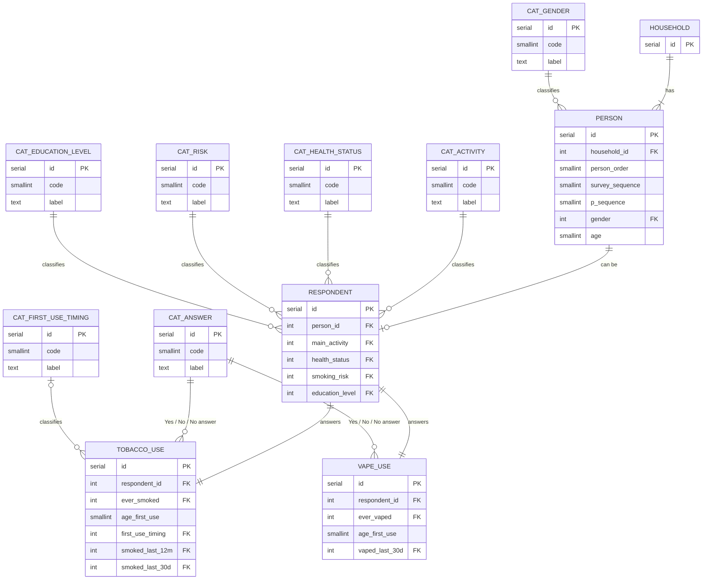
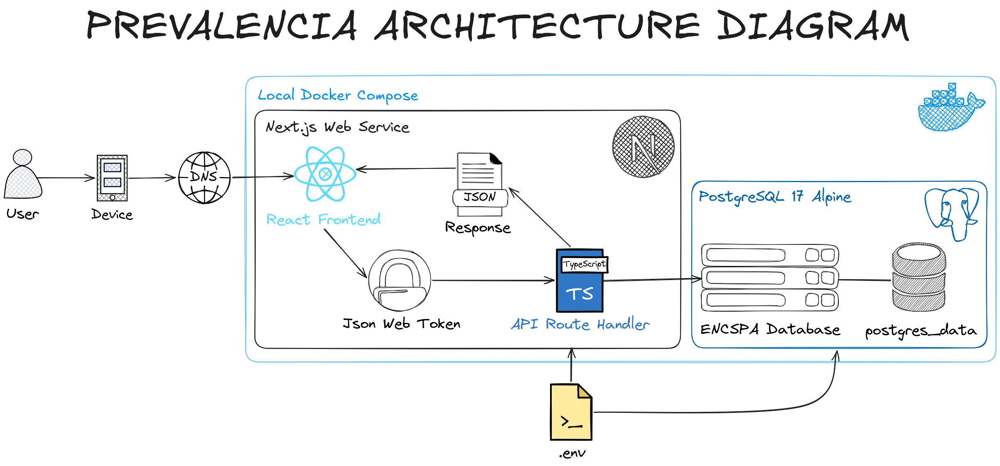

  

   
  
  
  
  
  

Prevalencia is a web platform for querying and visualizing information regarding tobacco consumption and the use of electronic cigarettes or nicotine vaporizers in Colombia.

---

## Entity Relationship Diagram

## Architecture Diagram

  

---

## License

This project is licensed under the [MIT License](./LICENSE).

## Author

- [IsaCode4](https://github.com/IsaCode4)
